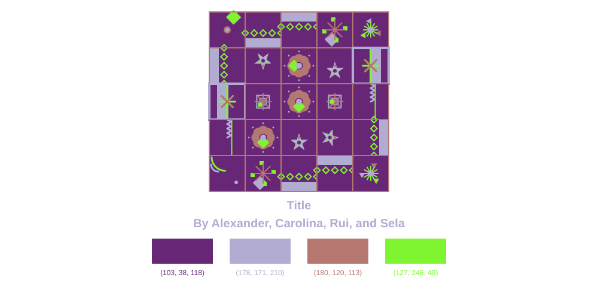

# Poster Generator



**Created by:** Sela, Rui, Alexander, & Carolina

**Course:** Creative Coding, Pratt Institute

**Semester:** Fall 2026

## About the Project

We each created a design for corner, border, and center tiles, as well as a color palette. In the final project, we combined all of our separate functions and palettes into one file so the user will have a randomly generated poster pattern.

The code first asks the user to name the poster, taking the user's input and storing it as the title. Then, the user chooses a palette, either one created by us or a random palette. The palettes we created are stored in dictionaries in the palette file. If random is selected, random RGB values are generated for each of the four colors. Then, the user provides the width and height for the pattern, with a minimum of 1 square and a maximum of 15 squares.

The poster is then created with Turtle. The code identifies if it should draw a corner, border, or center piece, and rotates it randomly (unless it's a corner). Then, the title is written under the final design.

## The Interface

When creating a poster, the user can give it a title, choose a color palette (one of the four we created, or a random set of colors), and decide the height and width of the poster.

## Meet the Designers

- **Sela:** My palette and tile designs are halloween-inspired!
- **Rui:** My palette is minimalistic with simple lines, dots, curves, and stars.
- **Alexander:** My palette ended up becoming easter themed but less vibrant, and my tile designs were inspired my love of geometric abstraction, as well as minimalism 
- **Carolina:** [Brief description of their tile designs or contribution.]

## Try it yourself

Copy this code into a Colab Notebook.

```python
!git clone https://github.com/thespookytoad/poster-generator
%cd poster-generator
!pip install -r requirements.txt
from project import generate_poster
generate_poster()
```

Or click below to open an example notebook in Google Colab and generate your own poster!

[](https://colab.research.google.com/drive/1ppcjdXaAjuqnIh_371KCbcKDyVTdePRd?usp=sharing)

### How to Use

1. Open the notebook in Google Colab.
2. Run the setup cells to download the project code and install the required libraries.
3. Run the cell that calls the function and prompts the user to choose a title, grid dimensions, and color palette.
4. Your own poster will be saved as poster.svg!

## Files

- `project.py` – Main poster-generation program.
- `functions.py` – Collection of custom tile-drawing functions.
- `palettes.py` – Available color palettes.
- `requirements.txt` – Required Python libraries.
- `poster.svg` – Example final poster image.
